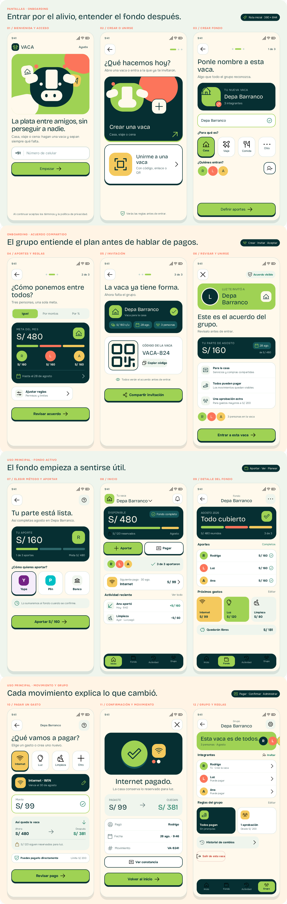

# Quería compartir gastos sin convertirme en el cobrador del grupo

## Resumen en 30 segundos

- **Problema:** en una casa compartida, alguien paga el recibo completo y después persigue a los demás. Las apps para dividir cuentas registran la deuda; el adelanto sigue saliendo de un solo bolsillo.
- **Decisión central:** moví el pago antes del gasto. El grupo aporta a un fondo común y los pagos salen de ahí.
- **Mi rol:** único diseñador. Hice el benchmark, el journey map, la definición del problema, los user flows, la arquitectura de información, el modelo de estados, el UI kit, 21 pantallas y el prototipo navegable.
- **Lo más difícil:** que tres personas lean el mismo saldo de la misma forma, también cuando un aporte está pendiente o un pago falla.
- **Formato:** proyecto conceptual con prototipo navegable de cinco tareas.


## Cómo organicé el trabajo

Usé el Double Diamond como estructura, con un artefacto concreto en cada fase:

| Fase | Pregunta | Artefactos |
| --- | --- | --- |
| Descubrir | ¿Qué pasa hoy y cómo lo resuelven otros? | Journey map del recorrido actual · benchmark de 4 productos |
| Definir | ¿Qué problema resuelvo y qué tengo que probar primero? | Jobs to be Done · How Might We · mapa de supuestos · criterios de éxito |
| Desarrollar | ¿Cómo funciona el producto y qué puede salir mal? | Comparación de 3 conceptos · 3 user flows · arquitectura de información · modelo de estados |
| Entregar | ¿Cómo se ve, cómo se siente y se entiende? | UI kit y tokens · 21 pantallas · prototipo navegable · plan de pruebas |

Con los flujos y el modelo de estados resueltos, pasé directamente a alta fidelidad y produje las pantallas con herramientas de IA.

## Descubrir

### El recorrido actual

Vaca nació de algo que me pasaba en casa. Reconstruí el recorrido a partir de mi experiencia en una casa de tres personas:


El cálculo toma un minuto; el seguimiento puede durar días. El punto más bajo llega al final, cuando quien adelantó el dinero tiene que cobrar. Cada dolor del mapa se convirtió en una oportunidad de diseño.

### Benchmark

Analicé en Mobbin los flujos de Splitwise, Monzo Split, Cash App Pools y Revolut Pockets según dos variables: cuándo se mueve el dinero y quién lo tiene.


**Hallazgo:**
- Las apps de deudas ordenan el «me debes», pero el adelanto ya ocurrió.
- Cash App Pools junta el dinero antes, pero lo concentra en un organizador.
- Revolut Pockets aparta dinero por tipo de pago, pero es individual.

Ninguno combina fondo previo grupal, dinero apartado por gasto y reglas compartidas. De cada uno tomé un patrón: saldos por persona de un vistazo (Splitwise, Monzo), progreso hacia una meta (Cash App) y dinero apartado por gasto (Revolut).

## Definir


- **Job to be Done:** cuando llega un gasto de la casa, quiero que se pague con la plata de todos, para no adelantar dinero ni perseguir a nadie.
- **How Might We:** ¿cómo podríamos pagar los gastos de una casa compartida sin que una persona adelante el dinero y tenga que cobrarlo después?
- **Supuestos más riesgosos:** que las personas acepten aportar antes del gasto, que confíen en un fondo custodiado por un tercero, que entiendan «apartado» y «sin asignar», y que una espera de minutos no provoque aportes duplicados. Son los cuatro que el diseño tiene que resolver primero.

## Restricciones y trade-offs

| Restricción | Qué decidí | Qué cedí |
| --- | --- | --- |
| No tengo un proveedor financiero real que custodie el dinero. | Diseñé Vaca como la interfaz de un fondo custodiado por una entidad regulada, y lo declaro como hipótesis. | No diseñé KYC, conciliación ni integración técnica. |
| Yape, Plin y la transferencia bancaria confirman en tiempos distintos. | El saldo solo cambia cuando el proveedor confirma; todo lo demás es «pendiente». | La app se siente menos inmediata durante esos minutos. |
| La marca es juguetona, pero maneja dinero ajeno. | Una regla: «jugar alrededor del dinero, nunca con el dinero». La mascota acompaña; los montos viven en superficies sobrias. | Sin confeti, rachas ni gamificación en pagos. |
| Tres semanas de iteración inicial. | Prioricé el ciclo crear → aportar → pagar y sus fallas. | Dejé fuera la salida de un integrante, las devoluciones y los aportes duplicados de otros integrantes. |

## Desarrollar: decisiones clave

### 1. Cambiar el orden: aportar antes de gastar

| Concepto | Qué resolvía | Por qué no bastaba |
| --- | --- | --- |
| Registrar deudas | Ordenaba quién debía qué. | Alguien seguía adelantando el dinero. |
| Recordatorios automáticos | Le quitaba a una persona la tarea de insistir. | El pago seguía ocurriendo después del gasto. |
| **Fondo previo** | Reunía el dinero antes de pagar. | Exigía reglas claras y confianza en quién custodia. |

Elegí el fondo porque era la única opción que eliminaba el adelanto. El costo: el producto tiene que ganarse la confianza para custodiar el dinero de un grupo. Las siguientes decisiones tratan sobre esa confianza.

### 2. Una sola lectura del dinero

En mis primeras versiones, la misma cifra aparecía como «libre», «reservado», «protegido» o «disponible». Cuatro nombres para dos conceptos hacían imposible saber cuánto se podía usar. Reduje el vocabulario a una ecuación que la interfaz nunca rompe:

```text
Saldo total = dinero apartado + dinero sin asignar
```

- **Apartado:** dinero destinado a un gasto concreto, como internet o luz.
- **Sin asignar:** dinero confirmado que el grupo todavía puede usar para algo nuevo.
- **Cubierto:** estado de un gasto cuyo monto está apartado completo.

Esta regla de contenido resolvió dos pantallas difíciles. Un pago desde lo apartado no toca el dinero sin asignar. Y un fondo insuficiente puede decir exactamente cuánto falta: «Faltan S/ 19 para la compra del mes».

### 3. Diseñar las ramas antes que las pantallas

Dibujé los tres flujos principales con todas sus ramas antes de diseñar una sola pantalla de error. El de pagar tiene cuatro puntos de decisión: si alcanza el dinero, si supera el límite del grupo, si alguien aprueba y si el proveedor confirma.


En el flujo de aportar separé «rechaza» de «aún no», porque piden acciones opuestas: ante un rechazo conviene reintentar; ante una espera, reintentar duplica el aporte.


### 4. Estados que no mienten

Modelé qué puede pasar con un aporte, un pago y una regla, y qué ve el grupo en cada caso. Sin el modelo, el flujo feliz parecía completo; con él aparecieron nueve situaciones sin diseñar.


La regla que más pesa: **mientras un resultado es incierto, la interfaz no ofrece repetir la operación.** Al construir el prototipo la llevé un paso más allá: si alguien intenta aportar con un aporte todavía en camino, Vaca lo detiene y explica que se sumaría dos veces.

### 5. Arquitectura: cuatro destinos, cuatro preguntas


Inicio responde cuánto hay; Fondo, cómo se reparte; Actividad, qué pasó; Grupo, quién decide. «Aportar» y «Pagar» son acciones dentro de Inicio y Fondo, no destinos de la navegación.

### Lo que descarté

- **La mascota en errores graves.** Aparece en esperas y errores recuperables, nunca en un comprobante ni junto a una cifra que alguien deba verificar.
- **Señalar a quien no aportó.** El recordatorio nombra monto y fecha; no muestra a una persona en rojo.
- **«Reintentar» en cualquier fallo.** Solo aparece cuando el rechazo está confirmado.

## Entregar: solución

### Flujo principal



### Nueve estados críticos

La ilustración 3D cambia según el estado; la hoja de datos conserva siempre la misma estructura: estado, título, explicación, cifra principal y una sola acción primaria.


### UI kit y fundamentos del sistema de diseño


Distingo con cuidado entre UI kit y sistema de diseño:

- **Lo que existe:**
  - un UI kit con 9 componentes base y sus estados;
  - 43 Design Tokens en formato DTCG;
  - patrones financieros para antes, durante y después de una operación;
  - reglas de voz y de accesibilidad.
- **Siguiente versión del sistema:** tokenizar todos los colores en uso, sumar tokens de componente, sincronizar la librería con código y definir versionado y gobernanza.

Una regla que añadí al sistema durante los estados críticos: el primario lima con relieve es para acciones cotidianas, como aportar o pagar; después de un error, el primario es tinta y sin relieve, para que la siguiente acción se lea con calma.

**Accesibilidad:** texto base de 16 px, áreas táctiles de 48 px y estados que nunca dependen solo del color. El objetivo es WCAG 2.2 AA.

### UX writing

Comparé cada mensaje crítico con la versión genérica que suele aparecer en apps de pago:

| Mensaje genérico | En Vaca | Por qué |
| --- | --- | --- |
| «Error en el pago» | «El internet quedó sin pagar. La plata no salió del fondo.» | Responde primero la duda real: si se perdió dinero. |
| «Procesando…» | «Llevando el pago a WIN. No lo pagues otra vez: te avisamos al terminar.» | Nombra el riesgo y la siguiente acción. |
| «Saldo insuficiente» | «Faltan S/ 19 para la compra del mes.» | Convierte un bloqueo en una cifra accionable. |
| «Libre», «reservado», «protegido», «disponible» (mis primeras versiones) | «Sin asignar» y «apartado» | Una sola palabra por concepto en todo el producto. |

### Cómo trabajé con IA

| Herramienta | Para qué |
| --- | --- |
| Mobbin | Benchmark |
| Brilliant | Flujo principal |
| Claude Code | Estados críticos, artefactos de proceso y prototipo en HTML, CSS y JavaScript |
| Three.js | Modelar y renderizar las ilustraciones 3D |
| Claude Design | Organizar todo en un lienzo editable |

Yo definí el problema, el modelo del dinero, los flujos, los estados, las reglas de contenido y el sistema, y revisé cada iteración. La IA aceleró la producción; las decisiones de este caso son mías.

## Validación

**Prototipo navegable:** un solo escenario de datos (S/ 480 = S/ 219 apartados + S/ 261 sin asignar) y un panel de moderación que reinicia cada tarea en su estado inicial.

### Recorrido cognitivo e iteración

Recorrí las cinco tareas principales del prototipo paso a paso, desde perfiles distintos: quien suele pagar primero, quien devuelve apenas le avisan y quien comparte casa por primera vez. Encontré cuatro fricciones y las corregí:

| Fricción | Cambio en el prototipo |
| --- | --- |
| El total de S/ 480 se leía como plata disponible. | La cifra protagonista de Inicio pasa a ser lo que se puede usar para gastos nuevos; el total baja a una línea secundaria. |
| La espera de un aporte no decía si Yape ya debitó. | El estado pendiente muestra los pasos, el tiempo habitual y qué pasa si no se confirma. |
| En un pago fallido, el error tapaba la buena noticia. | El título pasa a ser «No se descontó nada del fondo»; la causa baja al texto. |
| Un límite de S/ 200 parecía falta de saldo o de permisos. | El aviso aclara que hay saldo y que es una regla del grupo. |


### Criterios de validación

| Tarea | Criterio de éxito |
| --- | --- |
| Explicar cuánto se puede usar del fondo | Distingue «apartado» de «sin asignar» sin ayuda |
| Identificar por qué un aporte sigue pendiente | No intenta reenviarlo |
| Pagar internet sin afectar la luz | Completa el pago desde lo apartado |
| Recuperarse de un pago fallido | Explica que la plata no salió del fondo |
| Entender por qué un pago necesita aprobación | Nombra la regla del límite |

**Reglas de decisión:**

- Si menos de 4 de 5 personas distinguen «apartado» de «sin asignar», cambio esos nombres.
- Si alguien intenta reenviar un aporte pendiente, rediseño ese estado.
- Si la mayoría rechaza aportar por adelantado, vuelvo a la alternativa de recordatorios sin fondo.

## Impacto y aprendizajes

Definí las métricas de producto para un lanzamiento:

- **Activación:** porcentaje de fondos que completan el primer aporte de todos los integrantes.
- **Valor central:** porcentaje de gastos pagados sin que nadie adelante dinero.
- **Confianza:** consultas de soporte por aportes pendientes y pagos duplicados.

**Lo que aprendí:**

1. **El vocabulario es parte del modelo de datos.** Mientras el producto tuvo cuatro nombres para el dinero, ninguna pantalla podía ser clara.
2. **Las ramas definen la confianza más que el flujo feliz.** Un fondo compartido se gana o se pierde en el minuto en que un pago no confirma.
3. **Empezar por mi experiencia me dio velocidad.** El benchmark me obligó a separar mi forma de organizarme de lo que resuelven, o no, los productos que ya existen.

## Siguiente caso

### BBVA Perú

Diseñar un mailing de préstamo bajo restricciones de marca, canal y compliance.

- UX para email
- Salesforce Marketing Cloud
- Diseño responsive

CTA: Ver caso

Enlace: /casos/bbva
